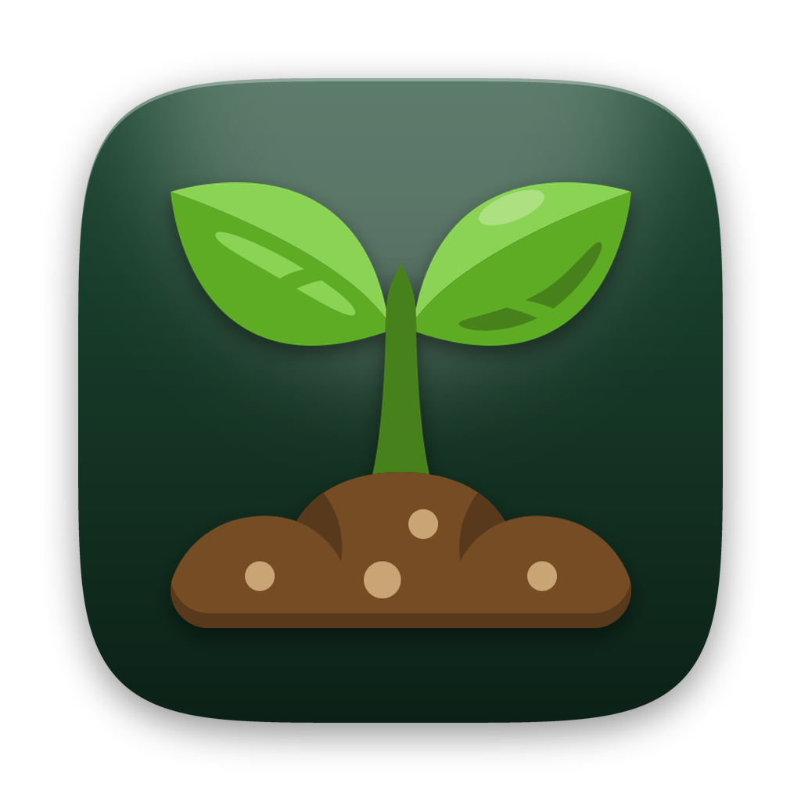
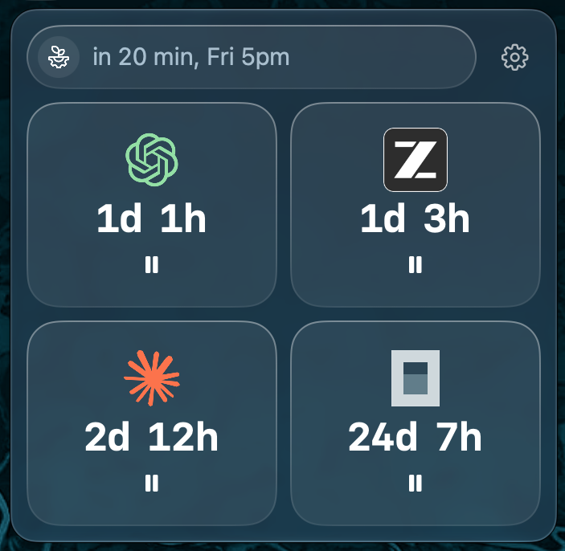
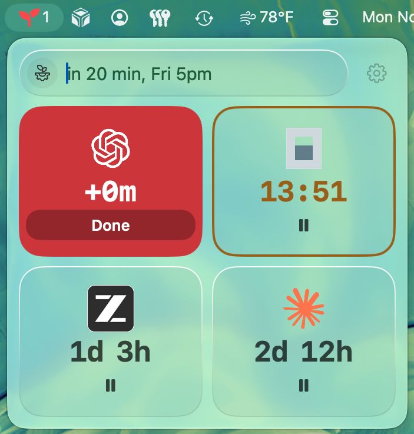

<div align="center">
  
  <h1>Till</h1>
  <p>A macOS menu-bar app that counts down to deadlines you type in plain words, and tells you once when time is up.</p>

  
  
  

  <p><a href="#build-and-run">Build</a> · <a href="#using-till">Use</a> · <a href="#status">Status</a> · <a href="#credits">Credits</a></p>
</div>

<p align="center">
  
  &nbsp;
  
</p>

<p align="center"><sub>Dark and light appearance. The light one shows an overdue tile, the due-soon outline, and the red menu-bar icon with its count.</sub></p>

## What it does

- **Type a deadline the way you'd say it.** `in 20 min`, `1 day 2 hours`, `Fri 5pm`. A line under the field reads back what Till understood before you press Return.
- **See every timer at a glance.** Each timer is a tile that shows its state: counting, due soon, overdue, or paused. The menu-bar icon turns amber or red, with a count of overdue timers.
- **Get one notification, then nothing more.** An overdue timer stays on screen until you mark it done.
- **Pick an icon for each timer.** Nine icons are built in and work offline. Or search the [Iconify](https://iconify.design) library.
- **Stay out of the way.** No Dock icon. Opening at login is optional.
- **Keep it private.** No accounts and no sync. The only network use is the icon search: Till downloads the icon previews it shows and the icon you pick.

## Build and run

There is no packaged release yet, so Till is built from source.

**You need:** macOS 26 or later, Xcode, and [XcodeGen](https://github.com/yonaskolb/XcodeGen) (the Xcode project is generated from `project.yml`). The deployment target is macOS 26; development has used Xcode 27 with the macOS 27 SDK, and no older Xcode has been tried.

```bash
git clone https://github.com/4w4vzkk24c-cyber/till.git
cd till
xcodegen generate
```

```bash
xcodebuild -project Till.xcodeproj -scheme Till -configuration Debug -destination 'platform=macOS' -derivedDataPath artifacts/DerivedData CODE_SIGNING_ALLOWED=NO build
```

```bash
open artifacts/DerivedData/Build/Products/Debug/Till.app
```

> [!NOTE]
> This build is unsigned and not notarized, and the bundle identifier (`com.crossedkeys.till`) is a placeholder. It is meant to be run on the machine that built it.

## Using Till

1. Click the seedling in the menu bar.
2. Type a deadline in the field.
3. Press Return. The timer appears as a tile.

| Type this | What happens |
|---|---|
| `in 20 min`, `20m`, `in 2 hours`, `3 days` | counts down from now |
| `1 day 2 hours`, `1h30m`, `1 hour and 30 minutes` | units combine, in any order, each used once |
| `Fri 5pm`, `fri 5:30pm`, `tomorrow 9am` | counts down to that time |
| `Nov 15` | asks which time that day |

**Tiles.** A neutral tile is counting. An amber outline means it is close to due. A solid red tile is overdue, and its **Done** button is the only way to clear it. A dashed tile is paused. Press the control on a tile to pause or resume it. Right-click a tile to **Edit** its deadline.

**The gear menu** has **Notifications**, **Open at login**, **About Till** (icon credits) and **Quit Till**. A dot on the gear means a setting needs attention, such as notifications being turned off in System Settings.

## Status

Pre-release, version 0.1.0 in `project.yml`. The logic is covered by automated tests; most of the interface has been checked by eye on one Mac. Not yet checked:

- VoiceOver and keyboard-only use. Every timer is spoken as "Timer", because timers have no names.
- Reduce Transparency and Increase Contrast.
- Notifications over days of real use, and a signed, notarized build.

The full record of what has and has not been run is in [`docs/evidence/2026-11-03-static-review.md`](docs/evidence/2026-11-03-static-review.md).

## Develop

```bash
xcodebuild -project Till.xcodeproj -scheme Till -destination 'platform=macOS' -derivedDataPath artifacts/DerivedData CODE_SIGNING_ALLOWED=NO test
```

Run `xcodegen generate` again after adding or removing source files. To rebuild the app icon from its source artwork: `python3 Design/AppIcon/make_icon.py` (needs [Pillow](https://pypi.org/project/pillow/)).

<details>
<summary>Repository layout</summary>

```text
Sources/Till/      app code
  Store/           SwiftData model, migration, timer store
  Icons/           Iconify search, fetch and cache; SVG rasterizer
  Views/           popover, tiles, composer, icon picker, theme
Tests/TillTests/   swift-testing suites
Design/AppIcon/    app icon source artwork and generator
docs/              design, specs, evidence, handoff, screenshots
project.yml        XcodeGen spec (the .xcodeproj is generated, not committed)
```

</details>

Design and context: [original design](docs/designs/2026-11-02-menu-bar-countdown-design.md) · [popover rework spec](docs/designs/2026-11-03-popover-rework.md) · [handoff notes](docs/handoff/2026-11-03-session-handoff.md)

## Credits

App icon: <a href="https://www.flaticon.com/free-icons/seedling" title="seedling icons">Seedling icons created by Umeicon - Flaticon</a>

The other bundled icons, with their authors and licenses, are listed in [`THIRD_PARTY_NOTICES.md`](THIRD_PARTY_NOTICES.md) and in the app's About panel. The Claude, OpenAI, Z.ai, opencode and Ollama marks are trademarks of their owners; Till is not affiliated with or endorsed by them.

## License

No license has been chosen yet. This repository does not include a license file.
